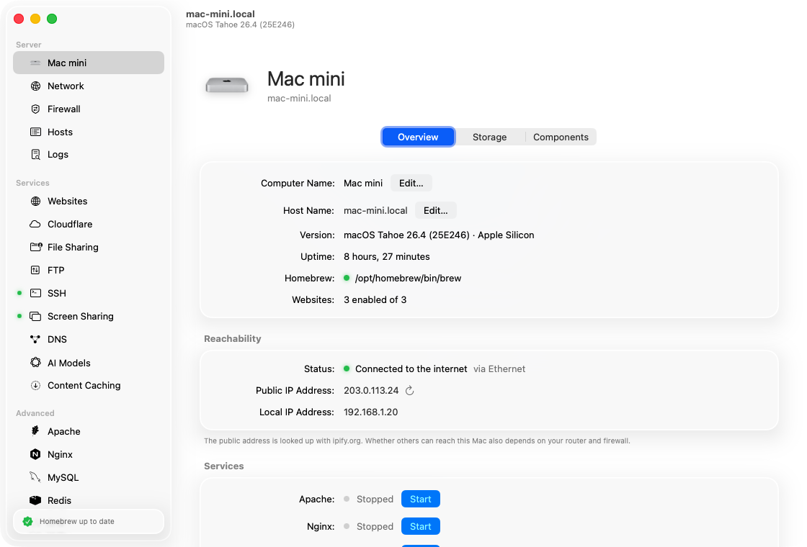

<p align="center">
  
</p>

<h1 align="center">Server</h1>

<p align="center">A native macOS app that replaces macOS Server, running websites, databases, DNS, FTP and more through Homebrew.</p>

<p align="center">
  <picture>
    <source media="(prefers-color-scheme: dark)" srcset="docs/screenshot-dark.png">
    
  </picture>
</p>

## Features

- **Websites** on Apache or Nginx, with PHP (5.6 to the latest 8.x) or Node.js, SSL and MySQL databases
- **Services**: Apache, Nginx, MySQL, Redis, FTP, DNS, SSH, File Sharing, Screen Sharing and Content Caching
- **AI Models**: an OpenAI-compatible server and chat web app using Apple's on-device model
- **Cloudflare** quick tunnels to share a website or the chat on the internet
- Network, Firewall, Hosts, Storage and central Logs
- Installs and updates Homebrew and the formulae it uses on its own
- **Automatic updates** from this repository's releases
- In English, Spanish, French, German, Italian, Portuguese (Brazil), Japanese, Korean and Chinese (Simplified), following your Mac's language

See [docs/FEATURES.md](docs/FEATURES.md) for the details.

## Install

Download the latest `Server-x.y.z.dmg` from [Releases](https://github.com/advandz/server-app/releases), open it and drag **Server** to **Applications**.

Runs natively on Apple silicon and Intel. It isn't notarized, so if macOS can't verify it, choose **Open Anyway** in **System Settings → Privacy & Security**.

## Build from source

```bash
./build.sh    # builds build/Server.app and build/Server-<version>.dmg
```

## Release

1. Set `VERSION` in `build.sh`.
2. Run `./build.sh`.
3. Tag and publish, attaching the DMG:

   ```bash
   git tag v1.0.0 && git push origin v1.0.0
   gh release create v1.0.0 build/Server-1.0.0.dmg --title "Server 1.0.0"
   ```

The app finds the newest version tag and offers to install the DMG attached to its release.

## License

Copyright © 2026 Advandz Technologies, LLC. Released under the [MIT License](LICENSE.md).
